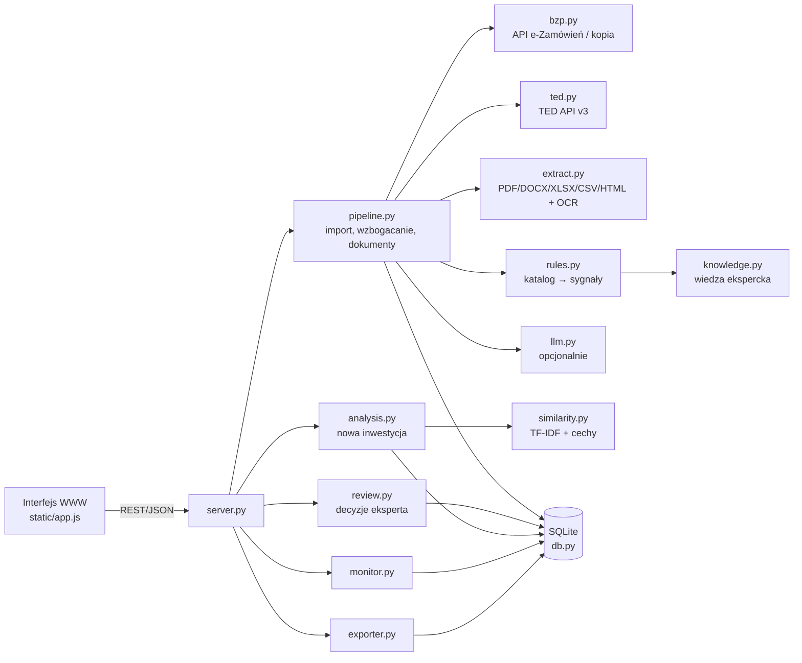

# Architektura i model danych

## Komponenty

Każdy moduł ma jedną odpowiedzialność; integracje (BZP, TED, LLM, OCR) są wymienne i konfigurowane w `config.json`.
Serwer to `http.server` z biblioteki standardowej — brak zależności, uruchomienie jednym poleceniem; produkcyjnie
można postawić go za reverse proxy lub przenieść trasy do FastAPI bez zmian w logice (`riskminer/*` nie zależy od HTTP).

## Przepływ automatycznego zasilania bazy

1. **Import rekordów** (`import_records`): rozpoznanie arkusza i nagłówków (aliasy), normalizacja identyfikatorów
   (BZP `RRRR/BZP NNNNNNNN/VV`, KPO, CST, OCID), walidacja NIP (suma kontrolna), odczyt adnotacji KPO (wartość,
   dofinansowanie, opis), klasyfikacja podsektora/rodzaju prac/formuły, długość sieci z opisu.
2. **Wyszukanie postępowania** (`enrich_project`):
   - identyfikator BZP → `ContractNotice` po `NoticeNumber` (fallback: okno roku publikacji + filtr lokalny),
     pewność 99% (obniżana przy niezgodności NIP);
   - KPO/CST/inne → `ContractNotice` w oknie dat → ocena kandydatów: NIP zamawiającego (0,45) + podobieństwo
     przedmiotu do nazwy/opisu (0,5×) + miejscowość (0,05) → do 4 kandydatów jako propozycje; najlepszy zakłada
     postępowanie „do weryfikacji”.
3. **Ogłoszenia powiązane** (`_related_notices`): `TenderResultNotice`, `NoticeUpdateNotice`,
   `ContractPerformingNotice`, ogłoszenia o zmianie umowy — po `OrganizationId` i dacie; dopasowanie:
   `tenderId` (99%) → numer ogłoszenia w treści (96%) → ten sam zamawiający + podobieństwo przedmiotu (35–85%).
4. **Fakty** (`bzp.parse_notice_facts`): etykiety formularzy BZP → wartość umowy, oferty min/max, liczba ofert,
   data zawarcia, okres/termin realizacji, data wykonania, łączna wypłata, należyte/terminowe wykonanie, kary.
   Każdy fakt: VAT (netto/brutto), cytat, źródło, pewność.
5. **Umowa i zmiany** (`_build_contract`, `_change_from_notice`): umowa składana z faktów; zmiany z podstawą
   prawną (art. 455 ust. 1 pkt 1–4, ust. 2).
6. **Zdarzenia** — trzy metody, wszystkie „do weryfikacji”:
   - *wyliczone* (`_computed_events`): wypłata > wartość umowy (E05), wykonanie po terminie (E04), niewykonanie
     należyte (E06), jedna oferta (R11), unieważnienie (E08), cena > kwota na sfinansowanie (R13);
   - *reguły* (`rules.scan_pages`): wzorce katalogu na zdaniach dokumentu → kategoria, typ, przyczyna („z powodu…”),
     działanie („w celu…”), skutek (dni, zł), z negacją („nie stwierdzono”) i wagą typu dokumentu;
   - *LLM* (opcjonalnie): JSON z dosłownym cytatem — cytat niezgodny z tekstem jest odrzucany.

## Uczenie z decyzji eksperta (bez zmian w kodzie)

- Każda decyzja o zdarzeniu z reguły zapisuje `rule_feedback`; pewność kolejnych trafień reguły mnożona jest przez
  `2·(zatwierdzone+1)/(decyzje+2)` (estymator Laplace’a precyzji reguły).
- Odrzucony fragment (odcisk reguła+tekst) nie wraca przy ponownej analizie.
- Analiza nowej inwestycji liczy częstość ryzyk z rozróżnieniem zatwierdzonych i proponowanych; projekty
  „wzorcowe” mają +10% podobieństwa.
- Katalog ryzyk, typy zdarzeń, podsektory, lista kontrolna i oczekiwane dokumenty są danymi w bazie (edycja w UI).

## Odczyt formularzy BZP

`bzp.parse_form` dzieli treść ogłoszenia na numerowane pola („5.4.3.) Podstawa prawna zmiany: …”), śledzi części
zamówienia („Część 2”) i odcina stopki. `bzp.extract_structured` buduje z tego fakty (wartość umowy, wypłata, termin
umowny i faktyczny, liczba ofert, wartość części) oraz listę zmian umowy (numer, podstawa, przyczyna, opis, wartość,
wzrost ceny). `pipeline._assign_parts` przypisuje ogłoszenia o wykonaniu/zmianie do części po wartości umowy lub
wykonawcy; `pipeline._reconcile` przy ponownie opublikowanym ogłoszeniu o wykonaniu tej samej umowy przyjmuje
najnowsze i zapisuje rozbieżności jako „jakość danych”, a zdarzenia z części spoza zakresu rekordu wyłącza.

## Analiza nowej inwestycji

1. Cechy z opisu/dokumentów: podsektor główny i dodatkowe, rodzaj prac, formuła, wartość (kwota przy słowach
   wartość/koszt/budżet), długość sieci, województwo.
2. Podobieństwo = Σ wag × podobieństwo cechy, normalizowane do cech porównywalnych:
   treść (TF-IDF z rdzeniami słów, 0,40), podsektor (0,20), wartość (log-ratio, 0,12), rodzaj prac (0,08),
   formuła (0,08), długość (0,07), region (0,05). Wyjaśnienie = wkład każdej cechy + wspólne rdzenie słów.
3. Statystyki grupy (min/p25/mediana/p75/max, **n** i lista projektów): odchylenie kosztu, opóźnienie, termin
   umowny, koszt/km, liczba ofert.
4. **Prognoza referencyjna** (`forecast.py`): klasa referencyjna = wszystkie umowy z wynikiem realizacji w BZP;
   waga = podobieństwo² (dopasowania niezweryfikowane ×0,25); ważone kwantyle P50/P80/P90 dla trzech rozkładów:
   rozliczenie vs szacunek inwestora (pole 4.3 ×1,23), rozliczenie vs cena umowy, czas faktyczny vs umowny;
   n_eff = (Σw)²/Σw², przedział P80 z bootstrapu (500 losowań, stałe ziarno). Szacunki równe co do grosza cenie
   umowy netto są pomijane. Kontrola krzyżowa: długość × koszt/km grupy.
4a. **Rejestr ryzyk z wyceną**: prawdopodobieństwo = ważony udział projektów ze zdarzeniem przyczynowym (formularz
   BZP, dokument, ekspert — bez zdarzeń wyliczonych, które są skutkami); skutek = mediana kosztu zmian / wartość umowy
   i mediana wydłużenia; EMV = p × skutek × wartość inwestycji; podstawy art. 455 Pzp z tytułów zmian.
4b. **Audyt klauzul** (`clauses.py`): 14 klauzul z wzorcami (obecność, wyłączenie, jakość — np. limit kar, kryterium
   pogody), wymogi ustawowe zależne od okresu realizacji odczytanego z materiałów (> 6 mies. → art. 439; > 12 mies.
   → art. 447; kary → art. 436 pkt 3); cytat z dokumentu i strony; priorytet = luka ustawowa + EMV ryzyk, które
   klauzula zabezpiecza.
5. Flagi: ryzyka obecne w ≥ 1/3 grupy lub ≥ 2 zatwierdzone; sygnały w opisie; reguły formuły (zaprojektuj i wybuduj
   → R04, R09); budżet/km poniżej p25 grupy → R13; ≥ 2 postępowania z jedną ofertą → R11.
6. Rekomendacje = działania, propozycje zapisów i kwestie do sprawdzenia z katalogu dla flag; zagadnienia = pozycje
   listy kontrolnej (materiał ekspercki, 9 punktów) nieobecne w opisie.

## Model danych (SQLite)

| Tabela | Zawartość | Kluczowe powiązania |
|---|---|---|
| `sources` | rodzaj (xlsx/bzp/ted/upload/url/manual), tytuł, URL, ref, **data pobrania**, sha256 | wskazywana przez wszystkie rekordy |
| `projects` | rekord organizatora + klasyfikacja, status wzbogacenia, flaga wzorcowy | 1–N procurements, facts, events, documents, links |
| `procurements` | postępowanie: nr BZP, tenderId, zamawiający, CPV, publikacja | `link_id` → podstawa i pewność dopasowania |
| `notices` | ogłoszenia (typ, numer, objectId, tenderId, treść, URL) | procurement, link, source |
| `contracts` | wykonawca, wartość, daty, wypłata, należyte wykonanie | procurement |
| `contract_changes` | data, podstawa prawna, opis, skutki | contract, notice |
| `facts` | koszt/termin: klucz, wartość, jednostka, VAT, **cytat, strona**, pewność, metoda, status | notice/document, source |
| `events` | kategoria R.., typ E.., tytuł, cytat, strona, skutki, przyczyna, działania, skuteczność, pewność, metoda, reguła, **status i decyzja eksperta** | project, procurement, contract, document/notice, source |
| `links` | propozycje powiązań: przesłanki (JSON), pewność, metoda, status, recenzent | project / procurement / document |
| `documents` | plik, typ, faza, tekst stronami, OCR | project lub analiza |
| `risk_catalog`, `event_types`, `knowledge` | wiedza ekspercka (edytowalna) | |
| `rule_feedback` | decyzje dla reguł (uczenie) | |
| `analyses` | analizy nowych inwestycji (wejście + wynik JSON) | documents |
| `monitor_events` | nowe ogłoszenia, istotne zmiany, sprzeczności | project |
| `audit_log` | historia wszystkich operacji (kto, co, przed/po, komentarz) | |

## Bezpieczeństwo i wdrażalność

- Klucze tylko w zmiennych środowiskowych; konfiguracja nie zawiera sekretów; UI pokazuje, gdzie przetwarzane są dane.
- Domyślnie serwer słucha na 127.0.0.1; Docker: użytkownik bez uprawnień root.
- Dane osobowe: system przetwarza dane podmiotów (NIP gmin, firm) z rejestrów publicznych; nie pobiera danych
  osób fizycznych; dokumenty przechowywane lokalnie.
- LLM opcjonalny i wymienny (także lokalny — Ollama/vLLM), więc brak trwałego uzależnienia od dostawcy.
- Rejestr operacji (`audit_log`) i źródeł (`sources`) dla każdego rekordu.
- Skalowanie: wątki zadań w tle, cache odpowiedzi API, limit zapytań; model danych przenaszalny do PostgreSQL.
